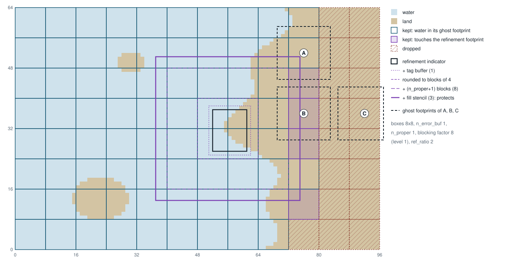

.. _PerformanceTuning:

Performance tuning
==================

This page collects the build and run-time settings that decide how fast REMORA runs, and
says what each one does to the answers. Where a statement rests on a measurement, the
measurement is the Upwelling problem at 1024 x 2048 x 40 cells (84 million cells) on one
Perlmutter CPU node (AMD Milan, 128 cores) or one Perlmutter GPU node (four A100s), for
ten time steps. Scaling results for earlier releases are on the :ref:`Performance` page.

The short version:

* Build ``Release`` with the profiler on, and read the inclusive ``REMORA::Evolve()`` time.
* On CPUs, measure a few tile shapes (``remora.omp_tile_size``) for your problem. The tile
  shape changed the time per step by 2x in our tests, more than any other single setting.
* One MPI rank per core on a node is as fast as any hybrid mix on that node. Threads pay
  off at scale and in memory per node, not in single-node throughput.
* On coastal domains, leave dry-box dropping on (the default) and fit the box size to the
  coastline on CPUs; on GPUs, use large boxes. It saved 28 % on a CPU node and 8 to 9 % on
  GPUs for a grid that is a third land.
* Leave floating-point contraction off (the default). It costs little and makes the
  answers independent of tiling, thread count and vectorization.
* Turn off the diagnostics you do not need: ``remora.sum_interval = -1``, ``remora.v = 0``,
  and plot and checkpoint intervals sized to what you will look at.

Build configuration
-------------------

**Build type.** ``CMAKE_BUILD_TYPE=Release`` (the CMake default) or ``DEBUG=FALSE`` with
GNU make. Debug builds are several times slower and change no answers.

**Profiler.** ``-DAMReX_TINY_PROFILE=ON`` (CMake) or ``TINY_PROFILE=TRUE`` (GNU make) adds
a small overhead and prints a table of timed regions at the end of the run. Two
tables appear: exclusive times (a region without the regions it calls) and inclusive
times. For comparisons between runs use the inclusive time of ``REMORA::Evolve()``; it
covers the time stepping and excludes initialization, the final plotfile and the profiler
itself. The exclusive table is the one to read when looking for the costliest kernel.

**Target CPU.** ``REMORA_ENABLE_NATIVE_ARCH=ON`` (CMake) or ``NATIVE_ARCH=TRUE`` (GNU make)
compiles for the CPU of the build machine (``-march=native``), which lets the stencil
kernels use that CPU's full vector width instead of the baseline x86-64 one. The binary
may then fail to start on an older CPU, which is why it is off by default; on a cluster
whose login and compute nodes differ, build on a compute node or use the compiler's
flag for the compute node's architecture instead. The gain depends on the problem and is
small when the step is limited by memory bandwidth (see `MPI ranks and OpenMP threads`_).
With contraction off (next item) it changes no answers: in our tests the ``-march=native``
build was bitwise identical to the default build.

.. _fp-contraction:

**Floating-point contraction.** Modern CPUs have a fused multiply-add instruction that
computes ``a*b + c`` with a single rounding, where the plain multiply and add round twice.
Compilers fuse ("contract") such pairs when the target has the instruction, which
``-march=native`` and the compiler wrappers of most clusters (Perlmutter's included)
enable. REMORA builds with contraction **off** by default: ``-ffp-contract=off`` for GCC,
Clang and the Intel LLVM compilers, ``-no-fma`` for classic Intel and ``-Mnofma`` for
NVHPC, applied to REMORA and to the AMReX sources of the same build (and, with GNU
Fortran, to the Fortran sources). An AMReX built separately and linked with
``REMORA_USE_INTERNAL_AMREX=OFF`` keeps the flags it was built with; build it with the same
flag for the guarantee below to cover the AMReX loops too.

The reason is reproducibility rather than accuracy. Which pairs a compiler fuses is a
heuristic, and it can fuse the same expression differently in the vectorized body of a
loop and in the scalar remainder that handles the last few cells of each row. Which cells
land in the remainder depends on where the tile and box edges fall, so with contraction
on, the answer depends on ``remora.omp_tile_size`` and on the domain decomposition. We
observed this in the vertical grid computation: the depths of the ``z`` levels differed in
their last bits between 8x8 tiles and 16-row strips, and the velocities differed at the
1e-8 level after five steps. With contraction off the arithmetic is exactly as written,
and the results are the same bitwise whatever the tiling, the thread count and the
vectorization (these are checked by the regression tests and the perf tests).

The cost is at most the fraction of the step spent in arithmetic that could have been
fused; on a bandwidth-bound step it is a few percent at most. Set
``REMORA_ENABLE_FP_CONTRACT=ON`` (CMake) or ``FP_CONTRACT=TRUE`` (GNU make) to allow
fusion again, with the tile-size dependence described above. Two further notes:

* The flag is a host-compiler flag and is applied to CPU builds only. GPU builds run no
  tiled host loops, so the issue does not arise there, and the device compilers keep their
  own defaults (``nvcc`` fuses by default). CPU and GPU results therefore differ at
  roundoff level, with or without this option.
* The regression tests are run without ``-march`` flags and so have never exercised
  contraction; a kernel that is tile-independent in ctest can still be tile-dependent in
  a contracting build. When changing kernels, also compare a ``-march=native`` build with
  contraction enabled at 8x8 tiles, 16-row strips and untiled.

MPI ranks and OpenMP threads
----------------------------

REMORA decomposes each level into boxes of at most ``amr.max_grid_size`` cells on a side
(``amr.max_grid_size_x`` etc. for different sizes per direction) and distributes the boxes
over the MPI ranks. Every rank should own at least one box; a rank with none idles. With
OpenMP, every ``MFIter`` loop of the time step is threaded over tiles (see `Tiling`_), so
the threads of a rank share its boxes. A rank whose box count times tile count is below
its thread count leaves threads idle; with tiling off, REMORA prints a warning when a
level's grids, at startup or after a regrid, leave some rank with fewer boxes than threads.

On one Perlmutter CPU node with the 84-million-cell problem, the time per step at full
occupancy was within a few percent for 128 ranks x 1 thread, 64 x 2, 32 x 4 and 16 x 8
(each with 128 x 128 boxes and the tiling that suits the thread count). The node's memory
bandwidth sets the time once every core is busy, and ranks and threads draw on the same
bandwidth. Hybrid runs pay off elsewhere: fewer and larger messages and less halo volume
at scale, and less memory per node (ghost cells, buffers, duplicated metadata).

Thread placement matters. Bind each rank to a set of cores and spread its threads over
them, for example with Slurm ``srun -c <2 x threads> --cpu-bind=cores`` plus
``OMP_PROC_BIND=spread OMP_PLACES=cores`` (Perlmutter cores have two hardware threads; use
one thread per core). Open MPI's ``mpiexec`` binds a run of one or two ranks to a single
core by default, so pass ``--bind-to none`` or a ``--map-by`` option that reserves cores for
the threads; otherwise every thread of the rank shares one core.

Tiling
------

``remora.omp_tile_size`` (an alias of ``fabarray.mfiter_tile_size``) gives the maximum
tile extent in each direction; a box is split into tiles of that size, each ``MFIter``
loop visits the tiles, and with OpenMP the tiles of a rank are shared out among its
threads. The default on CPUs is ``16 16 1024000``, columns of 16x16 cells spanning the
whole water column; GPU builds run untiled. The third component may not be smaller than
the number of vertical levels.

The tile shape sets the working set of each kernel pass and so how much of it stays in
cache between passes. On the Milan node, 16x16 tiles were the fastest shape at every
rank/thread mix tried (128 x 1, 64 x 2, 32 x 4), and they made the time per step nearly
the same for all three. 8x8 tiles were 5 to 10 percent slower, 16-row strips 25 to 35
percent slower, and the untiled run took twice as long as the best. On the 4-core
workstation the code was developed on, 16-row strips beat 8x8 tiles instead.
So the default is a reasonable starting point, not an answer: run a short timing of your
problem on your machine with

::

   remora.omp_tile_size = 8 8 1024000
   remora.omp_tile_size = 16 16 1024000
   remora.omp_tile_size = 1024000 16 1024000

and keep the fastest. When the box count is small relative to the thread count, smaller
tiles also mean more parallelism. The tile shape never changes the answers in the default
build (see :ref:`Floating-point contraction <fp-contraction>` for the exception).
``Tests/perf/README.md``
describes a script that runs such scans on Perlmutter and checks the plotfiles bitwise.

Grid layout and regridding
--------------------------

* ``amr.max_grid_size`` and ``amr.blocking_factor`` set the box sizes. One box per rank
  is the usual target on CPUs; on GPUs larger boxes (256 x 256 columns) amortize the
  kernel launches better and one box per GPU is best when the memory allows. A box always
  spans the whole water column (``amr.max_grid_size_z`` defaults to the number of vertical
  cells), so these only shape the boxes in x and y.

* Static nests do not need regridding. When the refined region never changes, set
  ``amr.regrid_int = -1`` so no time is spent tagging cells and rebuilding levels (see
  the notes on ``amr.regrid_int`` in :ref:`Inputs <sec:Inputs>`).
* The number of barotropic (fast) steps per baroclinic step, ``remora.ndtfast``, sets
  the cost of the 2D loop, which is the largest part of a single-level step. Use the
  smallest value that keeps the fast step stable.

Land
----

Coastal domains are often a third land or more, and REMORA computes land cells as fully as
wet ones: the land mask multiplies values, it does not skip cells. Two options use the mask
to spend less on land (details in :ref:`Land Layout <sec:LandLayout>`); neither changes the
answer.

Dry-box dropping
~~~~~~~~~~~~~~~~

``remora.drop_dry_boxes``, on by default, leaves out of level 0 every box that is land over
its whole footprint, that is its own cells and the ghost cells around them. No rank holds a
dropped box, so the time and memory it would have cost are saved outright, and the remaining
boxes are shared out among the ranks again. Boxes that are partly wet are kept whole, so the
saving depends on how well the boxes fit the coastline: smaller boxes leave out more land
but exchange more halo cells per wet cell. Start with boxes of 32 to 128 columns on CPUs
(``amr.max_grid_size``) and compare the "keeps N of M boxes" line printed at startup for a
few sizes. On a Perlmutter CPU node, a 52 M-cell grid with a staircase coastline and 36 %
land ran 28 % faster with dropping (best layout against best layout, and 27 to 38 % at
matched box sizes and rank/thread mixes); it dropped 23 to 32 % of the cells depending on
the box size, and the dropped runs took about the same time at every box size from 32 to
128. On GPUs, keep the boxes large: on four A100s the same grid ran fastest in boxes of 256
or 512 columns, where dropping still saved 8 to 9 %, while boxes of 128 columns or fewer
were slower whether boxes were dropped or not. Dropping is switched off automatically with
more than one refined level, with a refinement indicator that tags on a field, under the
atmosphere coupling driver and in builds with particles or MOAB. The solution is the same as
on the full domain, bitwise on every wet cell and wet face, with every forcing and boundary
option REMORA has; what differs is the layout. Plotfiles and checkpoints hold only the kept
boxes, NetCDF output puts the fill value in the dropped region, the integrated ``VOLUME``
diagnostic leaves the dropped land out, and some momentum-tendency scratch arrays in a
checkpoint can differ at land faces next to dropped boxes. Set
``remora.drop_dry_boxes = false`` to get the full-domain layout, for example to compare
against an older run with ``amrex_fcompare``, which needs equal box layouts; to compare two
layouts, use ``remora_subset_compare``, built with the regression tests.

Two margins decide which boxes go, as in :numref:`fig:drop_dry_boxes`. The *ghost footprint*
is the box grown by the three ghost rings the land mask carries (``NGROW + 1``), stopping one
cell past a non-periodic domain edge: a box is kept if any cell there is water, since its
stencils read those cells (box A). The *refinement footprint* protects the level-0 cells a
nest may need: each refinement indicator's box is grown by the tag buffer
(``amr.n_error_buf``), rounded out to blocks of the level-1 blocking factor divided by the
refinement ratio, grown by ``amr.n_proper`` + 1 such blocks (AMReX clears tags within
``n_proper`` blocks of a hole in the coarser level, which would shrink the fine grids), and
finally by the coarse cells the coarse-fine fills read. A box touching it is kept even if it
is all land (box B). A box outside both is dropped (box C). The figure is drawn by
``Docs/sphinx_doc/figures/drop_dry_boxes.py`` with the same rules as the code.

.. _fig:drop_dry_boxes:

         indicator near the coast and its nested margins, and three example boxes with their
         ghost footprints.

   Which level-0 boxes ``remora.drop_dry_boxes`` keeps, on an example grid in 8 × 8 boxes
   with ``amr.n_error_buf = 1``, ``amr.n_proper = 1``, a level-1 blocking factor of 8 and a
   refinement ratio of 2. Box A is all land but has water in its ghost footprint (dashed); box
   B is all land over its ghost footprint but touches the refinement footprint (solid purple);
   box C is outside both and is dropped.

Load balance
~~~~~~~~~~~~

``remora.load_balance`` weighs boxes by their wet cells when assigning them to ranks. The
default weighs a land cell like a wet one, which is right because every cell of a kept box
costs the same: weighing by wet cells alone (``remora.load_balance_land_weight = 0``) piles
land boxes onto some ranks. On the Perlmutter grid above, with dropped boxes, a land weight
of 0.5 was 5 to 15 % slower than the default and a weight of 0 was 21 to 44 % slower. The
option is there for platforms where a lower weight might help, and costs nothing when left
alone.

NetCDF input
------------

Gridded NetCDF inputs are read in parallel, each rank reading the part its own boxes cover,
and each input file is opened once while a level is initialized. What is left to choose is
the file format:

* **CDF-5 reads fastest.** On a 1536 x 1536 x 32 grid, reading the grid, initial and forcing
  files at start-up took about 3 s per rank from 128 to 1024 Perlmutter CPU ranks.
* **Compressed NetCDF-4 took 3.5 to 5 times as long** in the same test, mostly opening the
  files (parallel HDF5 reads the file metadata on every rank) and decompressing. Convert
  large inputs with ``nccopy -k cdf5`` when that is an option. If not, keep the chunks
  about the size of a box (see :ref:`icbc-parameters`): a rank decompresses every chunk its
  boxes touch, whole.

To see where start-up time goes, build with the profiler on: the
``BuildLocalFABsFromNetCDFFile::open``, ``::read`` and ``::close`` rows split each read into
opening, reading and waiting for the other ranks, ``NCReadSession::open_file()`` counts the
files actually opened, and ``remora.v = 1`` prints how much more than its own boxes any rank
reads (``NetCDF read region``), which should be close to 1.

Output and diagnostics
----------------------

* ``remora.sum_interval = -1`` turns off the integrated diagnostics (global sums of mass
  and tracers), which need a global reduction and a pass over the state each time they
  run.
* ``remora.v = 0`` suppresses the per-step reporting.
* ``remora.plot_int`` and ``remora.check_int`` control the plotfile and checkpoint
  frequencies. Writing a plotfile or checkpoint of a large domain costs the equivalent
  of several time steps, so size these to what you will look at and restrict
  ``remora.plot_vars_3d`` to the fields you need.

GPU
---

* Use one MPI rank per GPU, with ``amrex.use_gpu_aware_mpi = 1`` when the MPI library
  supports it, so halo exchanges move device memory directly.
* GPU builds run untiled; ``remora.omp_tile_size`` has no effect.
* The default box size gives a kernel launch per box per pass, so prefer few, large boxes
  per GPU. On the 84-million-cell problem with 256 x 256 boxes the four A100s of one
  Perlmutter node completed a step in a third of the time of the 128-core CPU node.
* Results differ from CPU results at roundoff level because the device compiler fuses
  multiply-adds (see :ref:`Floating-point contraction <fp-contraction>`).

Reproducibility
---------------

With the default build options the answers do not depend on the tile size, the number of
OpenMP threads or the compiler's vectorization choices; the regression suite has been
checked at one and two threads and at several tile sizes, and kernel changes are expected
to keep it that way. This relies on contraction being off and on two coding rules: a kernel
writes each cell of shared scratch from exactly one tile (or every tile that writes it
writes the same value), and sums whose order could vary, such as the coarse-fine flux
correction, are accumulated in a fixed order. Runs on different numbers of MPI ranks
agree bitwise for the same reasons as long as the box layout does not change the order
of such sums.
